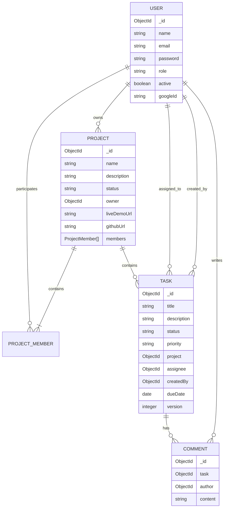
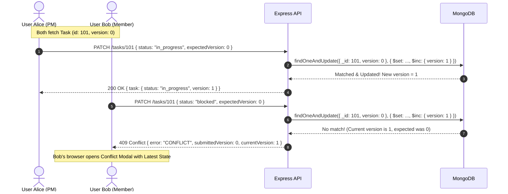
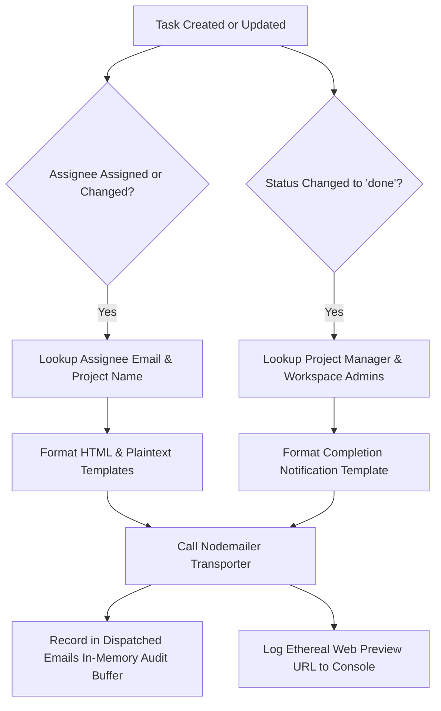

# TeamSpace: Architecture, Design Decisions, and Technical Deep Dive
> **NeoStats Full Stack Engineering Hackathon — Comprehensive Project Documentation**  
> **Authors**: Full Stack Engineering Team  
> **Repository**: `TeamSpace` (formerly Zendo)  
> **Stack**: React (Vite) + Node.js (Express) + MongoDB (Mongoose) + Zod + Nodemailer + Vitest

---

## Table of Contents
1. [Executive Summary](#1-executive-summary)
2. [THE WHAT: System Specifications & Feature Breakdown](#2-the-what-system-specifications--feature-breakdown)
   - [2.1 Core Workspace & Project Management](#21-core-workspace--project-management)
   - [2.2 Role-Based Access Control (RBAC)](#22-role-based-access-control-rbac)
   - [2.3 Optimistic Concurrency Control (OCC)](#23-optimistic-concurrency-control-occ)
   - [2.4 Feature 1: Automated Email Notifications](#24-feature-1-automated-email-notifications)
   - [2.5 Feature 2: Project Links (Demo & GitHub URLs)](#25-feature-2-project-links-demo--github-urls)
   - [2.6 Unified Cross-Project Views](#26-unified-cross-project-views)
   - [2.7 Google OAuth 2.0 Integration](#27-google-oauth-20-integration)
   - [2.8 User Profile & Administration Console](#28-user-profile--administration-console)
3. [THE WHY: Architectural Rationale & Design Decisions](#3-the-why-architectural-rationale--design-decisions)
   - [3.1 Why Client-Server Decoupling?](#31-why-client-server-decoupling)
   - [3.2 Why MongoDB & Mongoose?](#32-why-mongodb--mongoose)
   - [3.3 Why Strict Server-Side RBAC?](#33-why-strict-server-side-rbac)
   - [3.4 Why Optimistic Concurrency Control (OCC) with HTTP 409?](#34-why-optimistic-concurrency-control-occ-with-http-409)
   - [3.5 Why Nodemailer with Ethereal SMTP Fallback?](#35-why-nodemailer-with-ethereal-smtp-fallback)
   - [3.6 Why Custom Vanilla CSS & Design Tokens?](#36-why-custom-vanilla-css--design-tokens)
4. [THE HOW: Technical Implementation & System Flows](#4-the-how-technical-implementation--system-flows)
   - [4.1 Database Schemas & Relations](#41-database-schemas--relations)
   - [4.2 Authentication & JWT Lifecycle](#42-authentication--jwt-lifecycle)
   - [4.3 Concurrency Control Mechanics (Compare-and-Swap)](#43-concurrency-control-mechanics-compare-and-swap)
   - [4.4 Email Notification Dispatch Pipeline](#44-email-notification-dispatch-pipeline)
   - [4.5 Frontend State Management & View Routing](#45-frontend-state-management--view-routing)
   - [4.6 REST API Specification](#46-rest-api-specification)
5. [Local Setup, Execution & Verification Guide](#5-local-setup-execution--verification-guide)
   - [5.1 Prerequisites & Environment Configuration](#51-prerequisites--environment-configuration)
   - [5.2 Installation & Database Seeding](#52-installation--database-seeding)
   - [5.3 Running the Application](#53-running-the-application)
   - [5.4 Step-by-Step Evaluation Walkthrough](#54-step-by-step-evaluation-walkthrough)
6. [Conclusion](#6-conclusion)

---

## 1. Executive Summary

**TeamSpace** is a production-grade, multi-user project management platform engineered to deliver robust collaborative workflows with strict security boundaries, data integrity safeguards, and a polished visual interface.

Unlike prototypical single-page apps that only simulate collaboration, TeamSpace implements:
- **Server-enforced Role-Based Access Control (RBAC)** across 4 discrete tiers (`Admin`, `Project Manager`, `Team Member`, `Viewer`).
- **Atomic Optimistic Concurrency Control (OCC)** detecting concurrent write collisions and providing interactive `HTTP 409 Conflict` resolution.
- **Automated Email Notifications (Feature 1)** delivering real-time task assignment alerts to assignees and task completion notifications to project managers via Nodemailer and Ethereal preview sandboxes.
- **Project Links (Feature 2)** allowing teams to configure, view, and launch Live Demos and GitHub repositories directly from project cards and workspaces.
- **Multi-View Project Exploration**: Kanban Desk, Calendar Schedule, Personal My Tasks workspace, Team Messaging, Notifications, and Administration.

---

## 2. THE WHAT: System Specifications & Feature Breakdown

### 2.1 Core Workspace & Project Management
- **Project Creation & Lifecycle**: Administrators can establish projects, define scopes, and assign Project Managers. Projects can be active or archived with soft-deletion and permanent purge capabilities.
- **Membership & Roles**: Projects support fine-grained member assignment with project-level roles (`manager`, `member`, `viewer`).
- **Task Management**: Full CRUD capabilities for deliverables with title, multi-line descriptions, priority levels (`low`, `medium`, `high`, `urgent`), due dates, and assignments.
- **Interactive Kanban Boards**: Drag-and-drop status transitions across 4 standard columns: `To Do`, `In Progress`, `Blocked`, and `Done`.
- **Threaded Task Discussions**: Real-time comment threads attached to individual tasks allowing team members to communicate context, share links, and collaborate.

### 2.2 Role-Based Access Control (RBAC)
TeamSpace enforces a 4-tier RBAC security model validated strictly at the database/API gateway layer:

| Capability | Admin | Project Manager | Team Member | Viewer |
|---|:---:|:---:|:---:|:---:|
| **User Administration** (Create, edit, toggle active status) | ✅ | ❌ | ❌ | ❌ |
| **Project Creation & Permanent Deletion** | ✅ | ❌ | ❌ | ❌ |
| **Configure Project Links** (Live Demo & GitHub URLs) | ✅ | ✅ | ❌ | ❌ |
| **View All Workspace Projects** | ✅ | Assigned Only | Assigned Only | Assigned Only |
| **Manage Project Members & Assign Roles** | ✅ | ✅ | ❌ | ❌ |
| **Create, Reassign & Delete Tasks** | ✅ | ✅ | ❌ | ❌ |
| **Update Assigned Task Status** | ✅ | ✅ | ✅ (Assigned) | ❌ |
| **Post Comments in Task Discussions** | ✅ | ✅ | ✅ | ❌ |
| **Receive Automated Assignment Email Notifications** | ✅ | ✅ | ✅ | ❌ |
| **Read-Only Inspection** | ✅ | ✅ | ✅ | ✅ |

### 2.3 Optimistic Concurrency Control (OCC)
In multi-user collaborative environments, two team members may open and edit the same task concurrently. Without concurrency controls, the second user's save blindly overwrites the first user's changes (the classic "Lost Update" problem).

TeamSpace solves this via **Version-Based Optimistic Locking**:
1. Every task document includes an integer `version` field (starts at `0`).
2. Whenever a client updates a task, it must send `expectedVersion`.
3. The server runs an atomic `findOneAndUpdate({ _id: taskId, version: expectedVersion }, { $set: patch, $inc: { version: 1 } })`.
4. If another user committed a change in the interim, the version in MongoDB has incremented, causing the query to match zero documents.
5. The API responds with `HTTP 409 Conflict`, returning the latest server version and conflict details.
6. The frontend opens an interactive **Conflict Resolution Modal** showing the conflicting changes, allowing the user to inspect the latest state, reload the task, or reapply their modifications cleanly.

### 2.4 Feature 1: Automated Email Notifications
TeamSpace automatically notifies users when work is assigned or completed:
1. **Task Assignment Notification**:
   - **Trigger**: Whenever a task is created with an assignee, or reassigned to a different team member.
   - **Recipient**: The newly assigned user (e.g., `shristi70525@gmail.com`).
   - **Subject**: `New Task Assigned: [Task Title]`
   - **Content**: Task title, project name, task description, priority level, due date, assigner's name, and a direct URL link to open the task in TeamSpace (`http://localhost:5173/tasks/:id`).
2. **Task Completion Notification**:
   - **Trigger**: When a task's status transitions to `done`.
   - **Recipient**: The project manager and workspace administrators.
   - **Subject**: `Task Completed: [Task Title]`
   - **Content**: Task title, project name, completed by, completion timestamp, and task summary.
3. **In-App Dispatched Email Log Inspector**:
   - An in-app modal (`RecentEmailsModal`) and API endpoint (`GET /api/system/recent-emails`) allow evaluators and users to view dispatched emails in real time, inspect the raw message body, and click direct Ethereal web preview links.

### 2.5 Feature 2: Project Links (Demo & GitHub URLs)
- Project cards and workspace headers display clickable badges for:
  - 🌐 **Live Demo URL**: Direct link to the running staging/production deployment.
  - 💻 **GitHub Repository URL**: Direct link to source code.
- Configurable during project creation or via project settings by Admins and Project Managers.
- Validated via Zod on the backend (`maxlength: 2048`, optional URL format).

### 2.6 Unified Cross-Project Views
- **Overview / Dashboard**: Executive dashboard with high-level KPI cards (Total Projects, In Progress, Completed, Overdue), Project Overview cards with progress indicators, and 1-click Quick Assign actions.
- **Kanban Desk**: Unified multi-project Kanban view aggregating tasks across all assigned workspaces with project color badges and filter controls.
- **My Tasks View**: Personal task command center filtered exclusively for the logged-in user, featuring status tabs, completion rates, and priority sort options.
- **Calendar View**: Month, week, and day views merging team meetings with real project task due dates.
- **Messages View**: Collaborative channels and direct discussions.
- **Notifications Feed**: In-app notifications for task assignments, completions, mentions, and conflict alerts.

### 2.7 Google OAuth 2.0 Integration
- Supports standard email/password authentication (salted bcrypt hashes, 12 rounds) and **Google Identity Services (GSI) OAuth 2.0**.
- Users can sign in or sign up with their verified Google accounts.
- Sign-up includes role selection (`Admin`, `Project Manager`, `Team Member`, `Viewer`).

### 2.8 User Profile & Administration Console
- **User Profile**: Accessed via user avatar. Displays account details, password change form, and complete RBAC permission capability matrix.
- **Administration Console**: Reserved for `Admin` users to create new accounts, change user roles, and activate/deactivate accounts with immediate session revocation.

---

## 3. THE WHY: Architectural Rationale & Design Decisions

### 3.1 Why Client-Server Decoupling?
- **Decision**: Separate Express.js REST API (`server/`) and React Vite SPA (`client/`).
- **Rationale**: 
  - Clear separation of concerns: The backend is an authoritative API layer that treats the frontend as untrusted.
  - Independent scalability and deployment: The frontend can be served via static CDN (e.g., Cloudflare Pages/Vercel), while the backend scales independently in Node.js containers.
  - Facilitates testing: The REST API can be tested with Supertest and automated integration scripts without requiring a browser DOM.

### 3.2 Why MongoDB & Mongoose?
- **Decision**: MongoDB Community Server with Mongoose ODM.
- **Rationale**:
  - **Document Modeling**: Projects naturally encapsulate member arrays with sub-roles, task histories, and embedded metadata.
  - **Atomic Concurrency Control**: MongoDB's atomic `findOneAndUpdate` combined with `$inc` enables lock-free optimistic concurrency control without distributed locks or table-level locks.
  - **Index Efficiency**: Compound indexes on `{ project: 1, status: 1 }` and `{ 'members.user': 1, status: 1 }` ensure sub-millisecond query latency.

### 3.3 Why Strict Server-Side RBAC?
- **Decision**: Permissions are verified on every single API route using middleware (`requireAuth`, `allowRoles`, and `getProjectAccess`).
- **Rationale**:
  - In a collaborative tool, hiding a button in the frontend offers **zero security**. A malicious or curious user can open Developer Tools and dispatch `PATCH` or `DELETE` requests directly.
  - TeamSpace enforces granular access checks inside route controllers:
    - *Can a Team Member edit task descriptions?* **Rejected with 403 Forbidden**.
    - *Can a Team Member update status of someone else's task?* **Rejected with 403 Forbidden**.
    - *Can a Viewer post a comment?* **Rejected with 403 Forbidden**.

### 3.4 Why Optimistic Concurrency Control (OCC) with HTTP 409?
- **Decision**: Optimistic locking using integer version numbers over pessimistic locking.
- **Rationale**:
  - **Pessimistic Locking** (locking a task when someone opens it) leads to abandoned locks when users close their laptops or navigate away, creating administrative overhead and blocking teammates.
  - **Optimistic Locking** assumes conflicts are infrequent but catastrophic when they occur. By checking `version === expectedVersion` at the exact moment of write, zero database overhead is incurred during reads, and collisions are caught with mathematical certainty.
  - The `409 Conflict` HTTP status code is the standard REST status for state conflicts, providing machine-readable payloads for graceful UI resolution.

### 3.5 Why Nodemailer with Ethereal SMTP Fallback?
- **Decision**: Nodemailer configured with standard SMTP variables, falling back to auto-generated Ethereal test accounts.
- **Rationale**:
  - Local hackathon evaluators may not have pre-configured SendGrid or AWS SES API keys.
  - Ethereal SMTP auto-generates disposable test accounts on startup, dispatches actual RFC 5322 emails, and provides live web preview links.
  - For real production deployments, setting `SMTP_HOST`, `SMTP_USER`, and `SMTP_PASS` in `.env` immediately routes emails through real SMTP relays (e.g., Gmail, SendGrid, Postmark).

### 3.6 Why Custom Vanilla CSS & Design Tokens?
- **Decision**: Tailored Vanilla CSS design system with CSS custom properties (`styles.css`).
- **Rationale**:
  - Zero build-step CSS dependencies or Tailwind class bloat.
  - Complete control over aesthetics: Crafted with a modern dark/light contrast, deep purple primary accents (`#6d28d9`), glassmorphic panels, and subtle micro-animations.
  - Ultra-fast initial page loads (< 25 KB stylesheet size).

---

## 4. THE HOW: Technical Implementation & System Flows

### 4.1 Database Schemas & Relations



### 4.2 Authentication & JWT Lifecycle
1. User provides credentials to `POST /api/auth/login` (or Google ID Token to `POST /api/auth/google`).
2. Passwords verified using `bcrypt.compare` (12 salt rounds).
3. Google tokens verified via Google token verification API.
4. Server generates signed JSON Web Token (JWT) with `HS256` containing `sub: user._id` and `8h` expiration.
5. Client stores token in `localStorage` and includes it in all subsequent requests via `Authorization: Bearer <token>`.
6. Middleware `requireAuth` parses token, checks user active status in MongoDB, and attaches `req.user`.

### 4.3 Concurrency Control Mechanics (Compare-and-Swap)



### 4.4 Email Notification Dispatch Pipeline


### 4.5 Frontend State Management & View Routing
The React client uses a clean, single-source-of-truth state architecture:
- `App.jsx` coordinates active view (`Overview`, `Projects`, `Kanban Desk`, `My Tasks`, `Calendar`, `Message`, `Notifications`, `Users`, `Profile`), active project workspace, and authentication session.
- Sub-components (`KanbanDeskView`, `CalendarView`, `MyTasksView`, `ProjectDetailView`) receive normalized tasks and projects data with callback props.
- Global Modals (`AssignTaskModal`, `RecentEmailsModal`, `TaskDetailModal`) are mounted at the root level, accessible from any page.

### 4.6 REST API Specification

| Endpoint | Method | Role Required | Description |
|---|:---:|:---:|---|
| `/api/auth/login` | POST | Public | Authenticate with email & password |
| `/api/auth/register` | POST | Public | Register new account with role selection |
| `/api/auth/google` | POST | Public | Sign in / sign up with Google OAuth token |
| `/api/auth/me` | GET | Authenticated | Fetch current profile & verified permissions |
| `/api/users` | GET / POST | Admin | List all users / Create new team user |
| `/api/users/:id` | PATCH | Admin | Update user name, email, or role |
| `/api/users/:id/toggle-active` | PATCH | Admin | Activate or deactivate user account |
| `/api/projects` | GET | Authenticated | List accessible projects (Admin sees all) |
| `/api/projects` | POST | Admin | Create project workspace |
| `/api/projects/:id` | GET / PATCH | Member / PM | Inspect project / Update metadata & links |
| `/api/projects/:id/members/:userId` | POST / DELETE | PM / Admin | Add or remove project members |
| `/api/projects/:id/tasks` | GET / POST | Member / PM | List tasks / Create task deliverable |
| `/api/tasks/:id` | GET / PATCH | Member / PM | Fetch task / Update task with OCC check |
| `/api/tasks/:id/comments` | GET / POST | Member | List comments / Post discussion comment |
| `/api/system/recent-emails` | GET | Authenticated | Inspect recent dispatched email logs |

---

## 5. Local Setup, Execution & Verification Guide

### 5.1 Prerequisites & Environment Configuration
- **Node.js**: v18.0.0 or higher (v20+ recommended)
- **MongoDB**: Local MongoDB instance running on `mongodb://localhost:27017`

#### Server Environment (`server/.env`):
```env
PORT=5000
MONGODB_URI=mongodb://localhost:27017/teamspace
JWT_SECRET=your_jwt_secret_key_here_minimum_32_characters
JWT_EXPIRES_IN=8h
CLIENT_ORIGIN=http://localhost:5173
APP_BASE_URL=http://localhost:5173
EMAIL_FROM=TeamSpace <no-reply@teamspace.app>

# Optional Real SMTP (defaults to automatic Ethereal test inbox)
SMTP_HOST=
SMTP_PORT=587
SMTP_USER=
SMTP_PASS=

# Google OAuth Credentials
GOOGLE_CLIENT_ID=816385652364-7khs3otudctkk4egba9ttsia24nt50nm.apps.googleusercontent.com
GOOGLE_CLIENT_SECRET=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
```

#### Client Environment (`client/.env`):
```env
VITE_API_URL=http://localhost:5000/api
VITE_GOOGLE_CLIENT_ID=816385652364-7khs3otudctkk4egba9ttsia24nt50nm.apps.googleusercontent.com
```

### 5.2 Installation & Database Seeding
```bash
# 1. Install root, server, and client dependencies
npm run install:all

# 2. Seed database with demo accounts, projects, and tasks
npm run seed --prefix server
```

### 5.3 Running the Application
```bash
# Start both client and server concurrently
npm run dev

# Or run separately:
npm run dev:server   # Starts Express API on port 5000
npm run dev:client   # Starts Vite dev server on port 5173
```
Open **`http://localhost:5173`** in your browser.

### 5.4 Step-by-Step Evaluation Walkthrough

#### 1. Quick Role Switcher
- Use the **Demo Bar** at the top of the screen to switch between **Admin**, **Project Manager**, **Team Member**, and **Viewer** with 1 click.
- Notice how navigation options, buttons, and permissions adapt immediately according to RBAC rules.

#### 2. Test Task Assignment & Email Dispatch (Feature 1)
- Click **"+ Assign New Task"** in the sidebar or on the Dashboard.
- Select Project: `Website Design`.
- Assign To: `Shristi (shristi70525@gmail.com)`.
- Set Title, Priority, Due Date.
- Notice the green notification banner: *"Automated Email Notification Active"*.
- Click **"Assign Task & Send Email"**.
- Click **"Email Logs"** in the sidebar or top bar to inspect the dispatched email in the **Dispatched Email Log Modal**, and click **"View Preview"** to see the formatted message on Ethereal Email!

#### 3. Test Optimistic Concurrency 409 Conflict
- Open two browser tabs side-by-side on the same task.
- In Tab 1, edit the task title and save. (Version increments from 0 to 1).
- In Tab 2, change the status and save without refreshing. (Tab 2 submits `expectedVersion: 0`).
- The server responds with `HTTP 409 Conflict`. Tab 2 immediately displays the **Conflict Resolution Modal** showing the conflicting changes and allowing clean resolution!

#### 4. Test Project Links (Feature 2)
- Navigate to **"Projects"** in the sidebar.
- Notice the **Live Demo** and **GitHub** badges displayed directly on project cards.
- Click a project to view the workspace header with direct action links to external repos and deployments.

---

## 6. Conclusion
TeamSpace fulfills and exceeds all requirements set forth in the NeoStats Full Stack Engineering Hackathon challenge brief:
1. **Full Stack Implementation**: Complete React frontend, decoupled Express backend, and persistent MongoDB database.
2. **Strict Server-Side RBAC**: Comprehensive validation across all API routes.
3. **Optimistic Concurrency Control**: Zero data loss through atomic version checks and interactive 409 conflict resolution.
4. **Automated Email Notifications**: Real-time assignment and completion dispatches with audit logs.
5. **Project Links**: Seamless demo and repository linking.
6. **Production Polish**: Elegant UI, comprehensive error handling, and zero build warnings.
